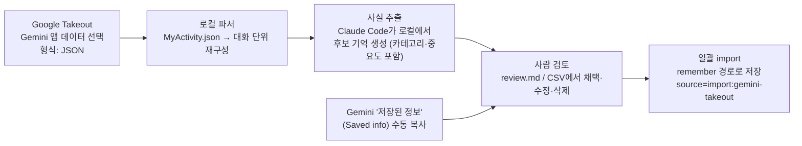

# Memory Hub — 아키텍처 초안 (v0.4)

> 여러 AI 클라이언트(Claude, Claude Code, Antigravity, Gemini 웹/앱, Pickle)가 **하나의 원격 MCP 서버**를 통해
> "나에 대한 정보"를 공유해서 컨텍스트가 파편화되지 않게 하는 개인용 메모리 시스템.

- 작성일: 2026-11-20
- 상태: Draft (설계 검토 중)
- 역할 분담: 설계·구축 = Claude Code / 포트폴리오 문서 = Antigravity
- 변경 이력
  - v0.1: 최초 초안
  - v0.2: Gemini 웹/앱 기준으로 변경, Pickle 연동 방식 확정(비 MCP 어댑터), 도메인 비교, Gemini 초기 데이터 이전 파이프라인, public 리포지토리 보안 정책 추가
  - v0.3: Gemini 커스텀 앱 불가 확인 → 비 MCP 클라이언트(Gemini·Pickle)를 Google Drive 단일 저장소로 통합, 도메인은 P3 직전 구매, 데이터 추출은 Claude Code로 확정
  - v0.4: 외부 저장소를 클라이언트별로 분리 — **Gemini → Google Docs, Pickle → Notion** (원본은 D1 하나 유지). Gem 문서 갱신은 즉시 반영되는 것으로 확인

---

## 1. 목표와 비목표

### 목표
1. **단일 진실 공급원(SSOT)**: 내 프로필, 선호, 진행 중인 프로젝트, 결정 사항을 D1 한곳에 저장
2. **클라이언트 무관**: MCP 표준(Streamable HTTP)을 지원하는 클라이언트는 직접 연결하고, MCP를 지원하지 않는 클라이언트는 **Bridge(동기화 어댑터)** 로 각자 쓰기 편한 저장소에 연결
3. **무료 운영**: 서버 운영비 0원 (도메인 구매만 비용)
4. **보안**: 개인 정보이므로 본인만 접근 가능 (OAuth / 토큰)
5. **포트폴리오 가치**: 설계 결정(ADR), 다이어그램, 테스트, 배포 자동화를 남길 것. 코드는 GitHub에 public으로 공개

### 비목표 (v1 범위 밖)
- 다중 사용자 / SaaS화
- 대화 원문 전체 자동 수집 (명시적으로 저장할 가치가 있는 정보만 저장)
- 자체 웹 UI (v2 후보)

---

## 2. 전체 구조

```mermaid
flowchart LR
    subgraph Native["MCP 직접 연결 (읽기·쓰기)"]
        C1["Claude (웹/데스크톱/모바일)<br/>Custom Connector"]
        C2["Claude Code<br/>claude mcp add --transport http"]
        C3["Antigravity<br/>mcp_config.json"]
    end

    subgraph NonMCP["MCP 미지원 → Bridge 경유"]
        C4["Gemini 웹/앱<br/>전용 Gem"]
        C5["Pickle 앱<br/>Connections: Notion"]
    end

    subgraph CF["Cloudflare (무료 티어)"]
        direction TB
        OAuth["OAuth 2.1 Provider<br/>(workers-oauth-provider)"]
        MCP["MCP Server<br/>Worker + McpAgent<br/>/mcp (Streamable HTTP)"]
        Sync["Bridge Sync<br/>Cron Trigger + 쓰기 이벤트<br/>renderer → sinks"]
        D1[("D1 (SQLite)<br/>memories / profile / audit<br/>+ FTS5 전문검색")]
        VEC[("Vectorize<br/>임베딩 인덱스")]
        AI["Workers AI<br/>임베딩 (bge-m3, 다국어)"]
        KV[("KV<br/>OAuth 토큰/세션")]
    end

    GH["GitHub OAuth<br/>(본인 계정만 허용)"]

    subgraph GSink["Google Drive (Gemini용)"]
        GDoc[("About Me<br/>Google Docs")]
        GInbox[("Memory Inbox<br/>방식 P3.5 결정")]
    end

    subgraph NSink["Notion (Pickle용)"]
        NPage[("About Me<br/>Notion 페이지")]
        NInbox[("Memory Inbox<br/>Notion 데이터베이스")]
    end

    C1 & C3 -->|OAuth 2.1| OAuth
    C2 -->|OAuth 또는 Bearer| MCP
    OAuth --> GH
    OAuth --- KV
    OAuth --> MCP
    MCP --> D1
    MCP --> AI --> VEC
    MCP --> VEC

    Sync <--> D1
    Sync -->|스냅샷 덮어쓰기| GDoc
    Sync -->|스냅샷 덮어쓰기| NPage
    GInbox -->|수집| Sync
    NInbox -->|수집| Sync
    C4 -->|읽기| GDoc
    C4 -.->|쓰기 (P3.5 검증)| GInbox
    C5 -->|읽기| NPage
    C5 -->|쓰기| NInbox
```

> **진짜 단일 진실 공급원은 D1 하나뿐**이다. Google Docs와 Notion은 D1에서 같은 렌더러로 만들어지는 "보기(view)"와 "쓰기 대기열"일 뿐이라, 외부 저장소가 두 개여도 데이터는 갈라지지 않는다.

### 왜 Cloudflare인가 (요약 ADR — 상세는 `docs/adr/0001`)

| 후보 | 장점 | 단점 | 판단 |
|---|---|---|---|
| **Cloudflare Workers + D1 + Vectorize** | 콜드스타트 거의 없음, MCP·OAuth 공식 SDK 존재, DB·벡터·임베딩·Cron까지 한 벤더 무료 | 벤더 종속, Workers 런타임 제약 | ✅ **채택** |
| Supabase(Postgres+pgvector) + Edge Functions | SQL 표준, pgvector | 무료 프로젝트 7일 비활성 시 일시정지 | 대안 |
| Render / Railway / Fly.io | 일반 Node/Python 서버 그대로 | 무료 티어 슬립·축소, 콜드스타트 | 탈락 |
| Vercel + Neon/Upstash | MCP 어댑터 존재 | 서비스 3개 조합, 함수 실행시간 제한 | 대안 |

> 개인 1인 사용량은 Workers·D1·Vectorize·Workers AI 무료 할당 안에 충분히 들어오는 것으로 판단. 정확한 한도는 구축 시점에 공식 가격 페이지로 재확인.

---

## 3. 클라이언트 연결 방식

| 클라이언트 | 연결 방법 | 인증 | 방향 |
|---|---|---|---|
| Claude (claude.ai / 데스크톱 / 모바일) | Settings → Connectors → Custom connector | OAuth 2.1 | 읽기·쓰기 |
| Claude Code | `claude mcp add --transport http memory-hub <URL>` (user scope) | OAuth 또는 Bearer 헤더 | 읽기·쓰기 |
| Antigravity | `mcp_config.json`에 `serverUrl` 등록 | OAuth / 헤더 | 읽기·쓰기 |
| **Gemini 웹/앱** | 전용 Gem 생성 → Google Drive `memory-hub/About Me` 문서를 지식으로 첨부 | Google 계정 | 읽기 (+ Inbox 쓰기 P3.5 검증) |
| **Pickle** | 앱 Connections에서 Notion 연결 → `About Me` 페이지 참조, `Memory Inbox` 데이터베이스에 기록 | Notion 계정 | 읽기·쓰기(Inbox 경유) |

### 3.1 저장소 선택 (ADR-0002 요약)

| 확인 사항 | 결과 |
|---|---|
| Gemini 커스텀 MCP 앱 ("Add a custom app") | ❌ 사용자 계정에 메뉴 없음 (지역·언어·구독 조건으로 추정) |
| Gemini ↔ Notion | ❌ Gemini Connected Apps 디렉터리에 Notion 없음 |
| Gemini ↔ Google Drive/Docs | ✅ 기본 지원 (Google Workspace 연동, Gem 지식 파일). 첨부 문서 갱신 시 **즉시 반영** 확인 |
| Pickle ↔ Notion | ✅ Pickle Connections에서 공식 지원 |

**결정: 클라이언트마다 가장 자연스럽게 연결되는 저장소를 쓴다 — Gemini는 Google Docs, Pickle은 Notion.**

- 하나로 합치는 것(v0.3)은 "Pickle이 Google Docs를 읽을 수 있다"는 확인되지 않은 가정에 기대야 했음
- 원본이 D1 하나이고 외부 저장소는 파생 보기라서, 저장소를 분리해도 **데이터 일관성에는 영향이 없음**
- 비용은 sink 코드 하나와 토큰 하나가 더 느는 정도. renderer(스냅샷 생성)는 공유
- Pickle 쪽은 Notion 데이터베이스를 Inbox로 쓸 수 있어 구조화된 쓰기(제목·카테고리·처리 상태)가 쉬움

### 3.2 Bridge 설계

**구조**: `renderer`(D1 → 스냅샷 마크다운, 공용) → `sinks`(Google Docs / Notion, 저장소별) + `inbox collectors`(저장소별) → `core` 서비스 계층

| 저장소 | 항목 | 형식 | 역할 | 쓰는 쪽 |
|---|---|---|---|---|
| Google Drive `memory-hub/` | `About Me` | Google Docs | 프로필 + 선호 + 진행 중 프로젝트 + 중요 기억 스냅샷 | Bridge Sync만 |
| Google Drive | `Memory Inbox` | Google Tasks 목록 또는 Docs (P3.5에서 결정) | Gemini의 쓰기 대기열 | Gemini |
| Notion | `About Me` | 페이지 | 위와 동일한 스냅샷 | Bridge Sync만 |
| Notion | `Memory Inbox` | 데이터베이스 (내용, 카테고리, 상태: 대기/처리됨/거부) | Pickle의 쓰기 대기열 | Pickle |

- **스냅샷 갱신**: (1) MCP 쓰기 발생 시 5분 디바운스 후 모든 sink 갱신 (2) 안전망으로 하루 1회 Cron 전체 재생성
- **Inbox 수집**: Cron(예: 30분)마다 각 Inbox를 읽어 `remember`와 같은 서비스 계층으로 저장(중복 검사·민감정보 필터 포함) → 처리 상태 기록, `source=gemini|pickle`
- **스냅샷 크기 제한**: 약 3~5천 자 이내 (중요도 상위 + 최근 항목). 문서가 커지면 응답 품질과 속도가 떨어지므로 요약본 성격 유지
- **인증 (최소 권한)**
  - Google: 본인 계정 OAuth refresh token, `drive.file` 범위(앱이 만든 파일만 접근)
  - Notion: Internal Integration 토큰, **`About Me` 페이지와 `Memory Inbox` 데이터베이스에만 공유** → 다른 워크스페이스 페이지 접근 불가

### 3.3 성능·기능 영향 분석

| 항목 | 영향 | 이유 |
|---|---|---|
| MCP 클라이언트(Claude 등) 응답 속도 | 없음 | Bridge Sync는 Cron/백그라운드(`ctx.waitUntil`)로 돌고 MCP 요청 경로에 끼지 않음 |
| 무료 한도 | 미미 | Cron 하루 수십 회 + Google/Notion API 호출 수십 회 수준 (Notion API 레이트 리밋 초당 약 3회 이내) |
| 비 MCP 클라이언트의 최신성 | 최대 수 분 지연 | 디바운스(5분) 이후 반영. Gem은 문서 갱신을 즉시 반영 |
| 비 MCP 클라이언트의 검색 능력 | 제한 | `recall`(의미 검색)을 못 쓰고 스냅샷에 든 내용만 앎 → 스냅샷 구성이 품질을 좌우 |
| 데이터 일관성 | 유지 | 원본은 D1 하나, 외부 저장소는 파생 보기 + 대기열 |

### 3.4 Gemini 쓰기 경로 (P3.5 검증 항목)

Gemini 웹/앱이 Inbox에 직접 쓰는 방법은 확실하지 않아 아래 순서로 검증한다.
1. Gemini의 Google Tasks 연동으로 `Memory Inbox` 할 일 목록에 항목 추가 (Tasks API는 개인 계정에서도 사용 가능)
2. Gemini 응답을 Google Docs로 내보내기 → Bridge가 `memory-hub/` 폴더의 새 문서를 수집
3. 위 방법이 모두 안 되면: Gem 지침에 "새로 알게 된 사실은 대화 끝에 `[MEMORY]` 블록으로 정리"하게 하고, 사용자가 Claude 등에서 저장 (수동)

## 4. 데이터 모델 (D1)

```sql
-- 장기 기억의 기본 단위
CREATE TABLE memories (
  id          TEXT PRIMARY KEY,          -- ULID
  content     TEXT NOT NULL,             -- 사람이 읽을 수 있는 한 문장~단락
  category    TEXT NOT NULL,             -- profile | preference | project | decision | knowledge | todo
  tags        TEXT,                      -- JSON 배열
  source      TEXT,                      -- claude, claude-code, antigravity, gemini, pickle, import:gemini-takeout
  importance  INTEGER DEFAULT 3,         -- 1~5
  created_at  TEXT NOT NULL,
  updated_at  TEXT NOT NULL,
  deleted_at  TEXT                       -- soft delete
);

-- 자주 바뀌지 않는 핵심 프로필 (key-value)
CREATE TABLE profile (
  key         TEXT PRIMARY KEY,          -- 예: name, language, job, tech_stack
  value       TEXT NOT NULL,
  updated_at  TEXT NOT NULL
);

-- 전문 검색 (키워드)
CREATE VIRTUAL TABLE memories_fts USING fts5(content, tags, content='memories');

-- 변경 이력
CREATE TABLE audit_log (
  id INTEGER PRIMARY KEY AUTOINCREMENT,
  memory_id TEXT, action TEXT, source TEXT, diff TEXT, at TEXT
);

-- 동기화 어댑터 상태 (외부 문서 ID, 마지막 동기화 시각, Inbox 커서)
CREATE TABLE sync_state (
  target      TEXT PRIMARY KEY,          -- gdoc:about-me, gtasks:inbox, notion:about-me, notion:inbox
  external_id TEXT NOT NULL,
  cursor      TEXT,
  synced_at   TEXT
);
```

- **Vectorize**: `memories.id` 를 벡터 ID로 사용, metadata에 `category` 저장 → 카테고리 필터 검색
- **검색 전략**: FTS5(키워드) + Vectorize(의미) 결과를 RRF(Reciprocal Rank Fusion)로 병합하는 하이브리드 검색
- **언어**: 기억 내용은 한국어로 저장, MCP tool 설명(description)은 영어로 작성 (모델 호환성)

---

## 5. MCP 인터페이스

### Tools
| 이름 | 설명 | 주요 파라미터 |
|---|---|---|
| `get_context` | 세션 시작 시 호출. 프로필 + 중요도 높은 기억 + 최근 기억 요약 반환 | `topic?` |
| `recall` | 하이브리드 검색 | `query`, `category?`, `limit?` |
| `remember` | 새 기억 저장 (유사 기억 있으면 중복 경고 반환) | `content`, `category`, `tags?`, `importance?` |
| `update_memory` | 기존 기억 수정 | `id`, `content?`, `tags?`, `importance?` |
| `forget` | soft delete | `id`, `reason?` |
| `set_profile` / `get_profile` | 핵심 프로필 key-value 관리 | `key`, `value` |
| `list_memories` | 최근/카테고리별 목록 | `category?`, `since?` |

### Resources / Prompts
- `memory://profile`, `memory://recent`
- `load_me` 프롬프트 — "내 컨텍스트를 불러와서 이 대화에 반영해"

### 중복/충돌 처리
- `remember` 시 벡터 유사도 ≥ 0.9 인 기존 기억이 있으면 저장하지 않고 후보를 반환 → 모델이 `update_memory`로 병합할지 결정
- Bridge Sync의 Inbox 처리, 초기 데이터 import도 **같은 저장 로직(서비스 계층)** 을 거침

---

## 6. 클라이언트 측 행동 규칙 (파편화 방지의 핵심)

| 클라이언트 | 규칙 위치 |
|---|---|
| Claude | 사용자 Preferences / 프로젝트 지침 |
| Claude Code | `~/.claude/CLAUDE.md` |
| Antigravity | 글로벌 Rules |
| Gemini 웹/앱 | 전용 Gem의 지침 ("`About Me` 문서를 먼저 참고, 새 사실은 `Memory Inbox`에 기록") + Saved info에 "나에 대한 정보는 memory-hub Gem 기준" 명시 |
| Pickle | 앱 내 지시 (Notion `About Me` 페이지 참고, 새 정보는 Notion `Memory Inbox` 데이터베이스에 기록) |

공통 규칙 초안:
```
- 대화 시작 시 memory-hub의 get_context를 호출해 나에 대한 정보를 불러온다.
- 내 선호·결정·진행 중 프로젝트·새 사실을 알게 되면 remember로 저장한다. (일회성 잡담은 저장하지 않음)
- 저장된 정보와 모순되는 내용을 들으면 update_memory로 갱신한다.
- 비밀번호, API 키, 주민번호 등 민감 정보는 절대 저장하지 않는다.
```
→ 규칙 원본은 리포지토리 `clients/`에서 관리.

---

## 7. 초기 데이터 이전 (Gemini → Memory Hub)

**원칙: 대화 원문은 서버에 올리지 않는다. 로컬에서 "사실"만 추출하고, 사람이 검토한 뒤 넣는다.**



1. **내보내기**: takeout.google.com → Gemini 앱(또는 내 활동 → Gemini 앱) 선택 → 형식을 **JSON**으로 변경 (기본값은 HTML)
2. **파싱**: Takeout 결과는 대화 아카이브가 아니라 **활동 로그(이벤트 배열)** 형태라서 시간순으로 묶어 대화 단위로 재구성
3. **추출**: 대화 묶음별로 "나에 대한 사실/선호/프로젝트/결정"만 뽑아 후보 목록 생성 (중복은 이 단계에서 1차 병합)
4. **검토**: 후보를 사람이 확인 — 민감 정보 제거, 오래된 정보 정리
5. **import**: 검토된 항목만 일괄 저장. `source`로 출처를 남겨서 나중에 롤백 가능
6. Gemini의 **저장된 정보(Saved info)** 는 Takeout에 없을 수 있으니 직접 복사해서 4단계에 합침

### 7.1 추출에 쓸 LLM: Claude Code로 결정 (ADR-0003 요약)

| 항목 | Claude Code (로컬) | Gemini API 무료 티어 |
|---|---|---|
| 추가 비용·설정 | 없음 (이미 사용 중, API 키 불필요) | API 키 발급, 호출 스크립트 작성 필요 |
| 개인정보 | 기존에 쓰던 서비스 범위 안에서 처리 | **무료 티어는 입력 데이터가 Google 제품 개선에 쓰일 수 있음** (약관 재확인 필요) |
| 처리 방식 | 대화형 — 애매한 항목을 바로 물어보고 검토까지 한 흐름으로 진행 | 배치 — 결과를 따로 검토해야 함 |
| 대용량 처리 | 대화 수천 개면 여러 세션으로 나눠야 함 | 레이트 리밋 안에서 자동 배치 가능 |
| 포트폴리오 | "AI 에이전트로 데이터 이전 자동화" 사례 | 일반적인 스크립트 |

→ **Claude Code**로 진행. 데이터 양이 너무 많으면 1차로 키워드/기간 필터링해서 줄인 뒤 추출.

- Takeout 원본과 중간 산출물은 `data/` 폴더에 두고 **`.gitignore`로 커밋 금지** (public 리포지토리이므로)
- 삭제된 대화나 활동 저장이 꺼져 있던 기간의 대화는 복구 불가

---

## 8. 도메인: `*.workers.dev` vs 개인 도메인

| 항목 | `workers.dev` 기본 도메인 | 개인 도메인 (Cloudflare Registrar 등) |
|---|---|---|
| **비용** | 0원 | 연 약 1~2만 원 (`.com` 기준, 원가 판매. `.dev`·`.kr` 등은 TLD별 상이) |
| **설정 난이도** | 즉시 사용 | 도메인 구매 + Cloudflare 존 연결 + Custom Domain 설정 (약 30분) |
| **WAF / 방화벽 규칙** | 존 단위 보안 규칙(WAF 커스텀 룰, 레이트 리밋 룰) 적용 불가 → 앱 코드에서 직접 처리 | 무료 플랜에서도 WAF 커스텀 룰·레이트 리밋 룰·Bot Fight Mode 등을 엣지에서 적용 가능 |
| **Cloudflare Access** | 지원 (Worker 단위) | 호스트명 단위로 더 세밀하게 적용 가능 |
| **URL 노출** | `<워커명>.<계정 서브도메인>.workers.dev` 형태라 계정 서브도메인이 드러남. 추측 가능성 다소 높음 | 원하는 이름. 계정 정보 노출 없음 |
| **이전성 (중요)** | 호스팅을 바꾸면 URL이 바뀜 → MCP 클라이언트 설정 + OAuth Redirect URI 전부 재등록 | 백엔드를 바꿔도 URL 유지 → 클라이언트 재설정 불필요 |
| **신뢰도 / 포트폴리오** | 개발용 느낌 | `mcp.내도메인.com` — 데모·문서에 보기 좋음 |
| **Cloudflare 권장** | 개인·취미 프로젝트용 | 프로덕션 용도 권장 |
| **리스크** | 거의 없음 | 갱신 누락 시 도메인 만료 → 서비스 중단·도메인 탈취 위험 (자동 갱신 필수) |

**결정: P2까지 `workers.dev`, P3 시작 직전에 개인 도메인 구매·전환**

- **P0~P2를 `workers.dev`로 해도 문제 없음**: 보안 핵심(OAuth, 단일 사용자 허용, 앱 레벨 레이트 리밋)은 도메인과 무관하게 동일하게 적용되고, 이 단계에 연결되는 클라이언트는 Claude Code·Claude 둘뿐이라 나중에 다시 등록하는 비용이 작음
- **전환 시 할 일** (체크리스트로 관리)
  1. 도메인 구매 (Cloudflare Registrar 권장 — DNS·Worker 연결이 한 곳에서 끝남, **자동 갱신 ON**)
  2. Worker에 Custom Domain 연결 (`mcp.<도메인>`)
  3. GitHub OAuth App의 callback URL 변경
  4. Claude 커넥터, Claude Code 설정의 URL 교체
  5. 엣지 보안 규칙 추가 (WAF 커스텀 룰: `/mcp`·`/authorize` 외 경로 차단, 레이트 리밋 룰)
  6. `workers.dev` 라우트 비활성화 (우회 경로 차단)
- **구매 시점을 늦추면 안 되는 경우**: P3.5에서 이메일 Inbox(`inbox@<도메인>`)를 쓰기로 하면 도메인이 필수
- URL은 코드에 하드코딩하지 않고 환경변수(`PUBLIC_BASE_URL`)로 두어 전환을 설정 변경만으로 끝낸다

---

## 9. 보안

- **인증**: OAuth 2.1 (PKCE, Dynamic Client Registration) — `workers-oauth-provider` + GitHub 로그인, **허용된 GitHub 사용자 ID 1개만 통과**
- **CLI용 대안**: 장기 Bearer 토큰 (해시만 저장, 회전 가능)
- **비밀 관리**: GitHub OAuth Secret, Google OAuth refresh token(`drive.file` 범위), Notion Integration 토큰 등 모든 키는 `wrangler secret` / GitHub Actions Secrets
- **민감 정보 필터**: `remember` 입력에 API 키/카드번호/주민번호 패턴 검사 → 거부
- **레이트 리밋**: 앱 레벨(토큰당 분당 제한) + 개인 도메인 사용 시 엣지 레이트 리밋 룰
- **외부 동기화 범위 최소화**: Bridge 스냅샷(Google Docs·Notion)에는 `importance ≥ 4` 또는 `profile`·`preference` 카테고리만 내보냄 (외부 서비스에 복제되는 정보 최소화)
- **백업**: GitHub Actions 주간 cron으로 D1 export → 암호화 후 **private** 저장소 또는 R2 (public 리포지토리에는 절대 저장하지 않음)

### 9.1 Public 리포지토리 정책 (코드만 공개)

| 항목 | 조치 |
|---|---|
| 비밀 커밋 방지 | `.dev.vars`, `.env*`, `data/`, `backups/`를 `.gitignore`. pre-commit에 `gitleaks`, GitHub **Secret scanning + Push protection** 활성화 |
| 개인 식별 정보 | 허용 GitHub 사용자 ID, 이메일 등은 코드가 아닌 secret/환경변수로 주입 |
| 설정 파일 | `wrangler.jsonc`의 D1·KV ID는 비밀은 아니지만, 예시 파일(`wrangler.example.jsonc`)만 커밋하고 실제 값은 로컬/CI에서 주입 |
| 테스트 데이터 | 실제 기억이 아닌 가짜 페르소나 데이터만 사용 |
| 커밋 이력 | 실수로 커밋한 비밀은 이력 재작성이 아니라 **즉시 키 폐기·재발급**이 우선 |
| 라이선스 | MIT (포트폴리오 공개용) |
| README | 아키텍처 다이어그램, 셀프 호스팅 방법, "데이터는 각자 계정에만 저장됨" 명시 |

---

## 10. 리포지토리 구조 (예정)

```
memory-hub/                     # GitHub public
├── src/
│   ├── index.ts                # Worker 엔트리 (fetch + scheduled), OAuth Provider 연결
│   ├── mcp/                    # McpAgent, tools/resources/prompts 정의
│   ├── core/                   # 저장·검색·중복검사 서비스 계층 (MCP/Sync/Import 공용)
│   ├── db/                     # D1 쿼리
│   ├── search/                 # FTS + 벡터 + RRF
│   ├── bridge/                 # Bridge Sync: renderer.ts(공용 스냅샷), sinks/{gdocs,notion}.ts, inbox/{gtasks,notion}.ts
│   └── auth/                   # GitHub OAuth 핸들러, 토큰 검증
├── migrations/                 # D1 SQL 마이그레이션
├── scripts/import-gemini/      # Takeout 파서, 사실 추출, 검토, 일괄 import (로컬 실행)
├── clients/                    # 클라이언트별 설정 예시 + 공통 규칙
├── tests/                      # vitest + @cloudflare/vitest-pool-workers
├── docs/
│   ├── architecture.md         # 이 문서
│   └── adr/                    # 설계 결정 기록 (Antigravity 포트폴리오 자료)
├── .github/workflows/          # CI, 배포, 백업, gitleaks
├── wrangler.example.jsonc
└── .gitignore                  # data/, backups/, .dev.vars, wrangler.jsonc
```

기술 스택: TypeScript · Cloudflare Workers(Cron Triggers 포함) · `agents` SDK(McpAgent) · `@modelcontextprotocol/sdk` · Zod · D1 · Vectorize · Workers AI · Google Drive/Docs/Tasks API · Notion API · Vitest · GitHub Actions

---

## 11. 구축 로드맵

| 단계 | 내용 | 완료 기준 |
|---|---|---|
| **P0** 뼈대 ✅ (배포 완료, Bearer로 Claude Code 연결 중) | Stateless MCP 핸들러, 8개 도구, trigram FTS 검색, Bearer 토큰, CI + gitleaks | 로컬에서 저장·조회 검증, 테스트 20개 통과 |
| **P1** 인증 ✅ (코드 완료, 배포·커넥터 연결 확인 대기) | OAuth 2.1 + GitHub 로그인 | claude.ai 커스텀 커넥터 연결 성공 |
| **P2** 검색 고도화 | Vectorize + 임베딩 + 하이브리드 검색, 중복 감지 | 한국어 의미 검색 동작 |
| **P2.5** 초기 데이터 | Gemini Takeout → Claude Code 추출 → 검토 → import | 검토된 기억 일괄 저장 완료 |
| **P3** MCP 클라이언트 | **개인 도메인 전환**, Antigravity 연결, 공통 규칙 배포 | MCP 클라이언트 3곳에서 같은 기억 조회 |
| **P3.5** Bridge | 공용 renderer → Google Docs(Gemini)·Notion(Pickle) sink, Notion Inbox 수집, Gemini 쓰기 경로 검증 (3.4절) | Gemini·Pickle이 About Me를 읽고, Inbox 기록이 D1에 반영됨 |
| **P4** 운영 | CI/CD, 백업, audit log, 레이트 리밋 | main 푸시 시 자동 배포 |
| **P5** 포트폴리오 | ADR 정리, 다이어그램, 데모 영상 → Antigravity에 인계 | 포트폴리오 문서 완성 |

---

### P0 구현 메모 (설계 대비 변경점)
- **MCP SDK v2(`@modelcontextprotocol/server`) + `agents`의 stateless `createMcpHandler`** 사용. 요청마다 서버를 새로 만들어 Durable Object가 필요 없음 → 구조 단순화, 무료 한도 절약. 2025년 프로토콜 클라이언트도 레거시 호환 경로로 처리됨
- **검색**: FTS5 `trigram` 토크나이저 + 검색어별 부분 일치 점수. 형태소 분석기 없이 한국어 검색 가능, 조사(을/를/에서 등)는 검색어에서 제거
- **중복 감지**: P0은 정규화 후 완전 일치만. 의미 유사도 중복은 P2(Vectorize)에서
- **`source`**: 현재는 도구 인자로 받음. P1에서 OAuth 클라이언트 정보로 자동 기록 예정

### P1 구현 메모 (설계 대비 변경점)
- **`@cloudflare/workers-oauth-provider` 1.x의 `OAuthProvider`(단일 Worker)** 사용. `/mcp`만 보호 API, 나머지(`/authorize`, `/callback`, `/health`)는 기본 핸들러
- **Confused deputy 방지**: DCR로 아무 클라이언트나 등록할 수 있으므로, GitHub로 보내기 전에 **클라이언트별 승인 페이지**를 항상 거침. 라이브러리의 `beginConsent/approveConsent`(브라우저 바인딩 `__Host-` 쿠키, 1회용 핸들, `frame-ancestors 'none'`)와 `beginUpstream/finishUpstream`(승인 후에만 생기는 `state`, 브라우저 바인딩) 사용. 승인 기억(remember consent)은 쓰지 않음 — 새 클라이언트 연결 시에만 뜨고, 이후엔 refresh 토큰으로 유지되므로 불편이 작음
- **GitHub**: PKCE(S256) 사용, scope 없음(공개 프로필의 숫자 `id`만 필요). GitHub 토큰은 ID 확인 후 버림 → 서버는 GitHub API 권한을 보유하지 않음. 허용 판정은 바뀔 수 있는 `login`이 아닌 **숫자 ID**로
- **Bearer 토큰 병행**: `resolveExternalToken`으로 `MCP_TOKEN`을 계속 허용 (CLI 대안). secret을 지우면 OAuth 전용
- **`source` 자동 기록**: 승인 시 OAuth 클라이언트 이름(예: "Claude" → `claude`)을 grant props에 저장 → 도구 인자에 `source`가 없으면 이 값 사용
- **CIMD 지원**: 최신 MCP 인증 스펙의 Client ID Metadata Document도 허용 (`global_fetch_strictly_public` 호환성 플래그 필요)
- **토큰 수명**: access 1시간, refresh 30일(사용 시 연장)
- **`PUBLIC_BASE_URL`**: OAuth 메타데이터의 resource/issuer와 GitHub callback에 사용 → P3 도메인 전환 시 vars + GitHub OAuth App callback만 변경

---

## 12. 결정된 사항 / 열린 질문

### 결정됨
- Gemini는 **웹/앱** 기준 (CLI 아님). 커스텀 MCP 앱 메뉴 없음 → **Gem + Google Docs**
- 비 MCP 클라이언트는 저장소 분리: **Gemini → Google Docs(Gem)**, **Pickle → Notion** (원본은 D1 하나, 공용 renderer)
- Gem 첨부 문서 갱신은 즉시 반영됨 (사용자 확인)
- 초기 데이터는 **Gemini Takeout** → **Claude Code**로 로컬 추출 → 검토 → import
- 도메인: P2까지 `workers.dev`, **P3 직전 개인 도메인 구매**
- 리포지토리: **코드만 GitHub public**, 데이터·백업은 비공개

### 열린 질문 (P3.5에서 실제로 확인)
1. Gemini가 Inbox에 쓸 수 있는 경로 (Google Tasks / Docs 내보내기 / 수동) 중 어떤 것이 동작하는지?
2. Pickle이 Notion 데이터베이스에 정해진 형식(내용·카테고리·상태)으로 안정적으로 기록하는지?

### 참고 자료
- Pickle: [What is Pickle?](https://www.pickle.com/help/start/what-is-pickle), [Help](https://www.pickle.com/help)
- Gemini 커스텀 MCP: [docstash.ai](https://docstash.ai/blog/gemini-custom-mcp-connectors), [usecarly.com](https://www.usecarly.com/blog/gemini-mcp/), [Medium (Google Cloud)](https://medium.com/google-cloud/supercharging-the-gemini-app-with-custom-mcp-connectors-skills-and-live-github-access-d82c6cca5d85) — 서드파티 자료, 공식 도움말로 재확인 필요
- Gemini 연결 앱 목록(Notion 없음): [usecarly.com – Gemini Connectors](https://www.usecarly.com/blog/gemini-connectors/)
- Gemini 데이터 내보내기: [Download your Gemini Apps data (Google)](https://support.google.com/gemini/answer/16920332)
- Cloudflare 도메인: [workers.dev](https://developers.cloudflare.com/workers/configuration/routing/workers-dev/), [Custom Domains](https://developers.cloudflare.com/workers/configuration/routing/custom-domains/)
